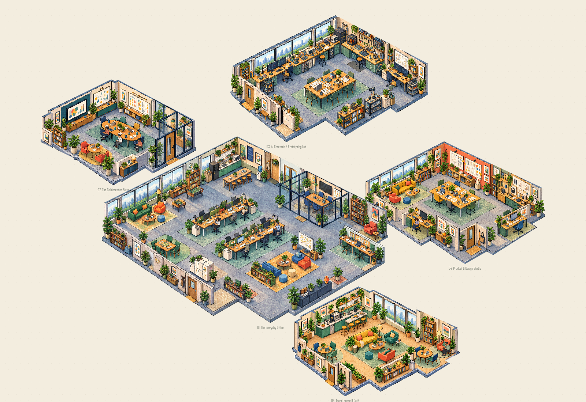

# The Everyday Office

An illustrated technology-company campus built with React, TypeScript, Vite and the HTML5 Canvas API. Five distinct raster environments share one camera, a cream background and ten adult coworkers with independent schedules.



The image above is a Canvas renderer review, not a live browser screenshot.

## Explore five environments

1. **The Everyday Office** — the original open-plan office and workstations.
2. **The Collaboration Suite** — meeting table, presentation screen, planning boards and discussion nook.
3. **AI Research & Prototyping Lab** — testing benches, specialist monitors and experimental hardware.
4. **Product & Design Studio** — interface boards, design reviews, prototypes and creative worktables.
5. **Team Lounge & Café** — coffee counter, lounge seating, books and informal work areas.

Each room has its own artwork, silhouette, world position, activity points, furniture footprints and six intermittent ambient events. The approved ten coworkers appear once across the campus: three in the office, three in collaboration, two in research, one in design and one in the lounge. Clothing and identities are reused consistently.

## Run

Requires Node.js 24+ and npm. No API key or external AI service is required.

```sh
npm ci
npm run dev
```

Open the URL printed by Vite. Append `?motion=full` to explicitly enable animation when the operating system requests reduced motion.

```sh
npm test
npm run lint
npm run build
npm run preview
```

The production output is a static `dist/` bundle suitable for a static web host.

## Controls

Drag the Canvas to pan; scroll to zoom around the pointer. Use the zoom/reset buttons or select a room in the navigation strip to focus it. Click a room to select its silhouette. Reset fits the complete five-room world. The overview adapts to the viewport.

## Architecture

- `src/world/roomData.ts`: active room entities and preserved historical fixtures.
- `src/world/campusData.ts`: staff assignments, navigation footprints, activity anchors and ambient events.
- `src/assets/rooms/manifest.ts`: raster placement, scale, clipping and hit-test silhouettes.
- `src/living/OfficeSimulation.ts`: independent work, travel, conversation and briefing lifecycles.
- `src/living/OfficeNavigation.ts`: reusable room navigation with furniture and coworker clearance.
- `src/living/CampusWorld.ts`: the five simulations and ten unique coworkers.
- `src/living/CampusAmbience.ts`: stillness, short event, stillness.
- `src/rendering/`: Canvas rendering, image caching, raster occlusion and scene depth.
- `src/camera/` and `src/engine/`: camera, coordinate conversion and interaction.

Artwork stays separate from animated people. The environment renderer uses local PNG files rather than HTML/CSS pseudo-3D, SVG rooms, WebGL or Three.js. Animation stays in requestAnimationFrame without per-frame React state updates.

## Validation and limits

Fourteen tests pass locally, including three twenty-minute behavior simulations and campus route/distribution checks. The production Canvas renderer was also exercised in an offline Canvas harness: all five artwork layers loaded, all silhouettes fit the overview, all five room-center selections matched, and overview/focused views were visually inspected. These are actual renderer outputs, not browser screenshots.

In the public checkout, the optional historical-art hash test is skipped because
inactive legacy illustrations are not distributed. The other thirteen tests remain enabled.

Live browser interaction/console checks remain unverified because the available browser tool rejected local-page access. Characters stay within assigned rooms; cross-room travel is not implemented. The shared six-pose atlas provides stylized gestures, rather than complete directional/seated animation for every task. Furniture collision tests cover authored ground footprints, not every tiny decorative pixel.

An optional development review harness uses the already-installed Rolldown compiler and an externally supplied `@napi-rs/canvas` installation. Run `node scripts/campus-review.mjs /path/to/node_modules` if that package is available. It is not required to run or build the app.

## License and contributions

See [LICENSE](LICENSE), [artwork provenance](ARTWORK.md), [third-party notices](THIRD_PARTY_NOTICES.md), [contributing](CONTRIBUTING.md) and [security](SECURITY.md). Reference screenshots, private recordings and local review outputs are excluded from the public repository.
